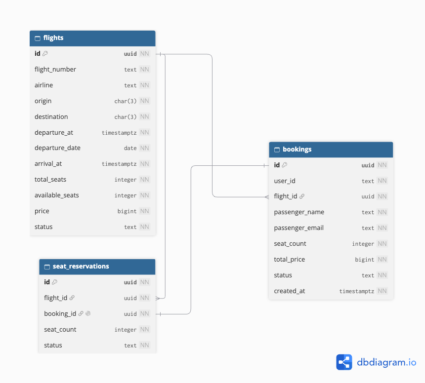

# HW3 — Flight Booking (4 балла)

Два синхронных сервиса на Python: Booking (FastAPI REST) → Flight (gRPC).
У каждого своя PostgreSQL. Рабочая версия для пунктов 1–4.
REST-обработчики, gRPC и запросы к БД синхронные.
Одновременные запросы обрабатываются потоками; async остаётся только в служебном lifespan FastAPI.
Для каждого обращения к БД открывается отдельное подключение без пула.
Booking `/health` проверяет только свою БД. Compose ожидает готовности баз и Flight перед запуском Booking.

## Запуск

Из папки `HW3`:

```bash
docker compose up --build
```

Миграции Alembic применяются автоматически. Данные сохраняются между запусками.
Swagger: http://localhost:8000/docs. gRPC доступен между контейнерами по адресу `flight:50051`.
Остановка: `docker compose stop`.

Демонстрационный рейс: `11111111-1111-4111-8111-111111111111`, SU1234,
SVO → LED, 2026-12-01 10:00 UTC, 100 мест, 5000 RUB за место.

```bash
curl 'http://localhost:8000/flights?origin=SVO&destination=LED&date=2026-12-01'
curl -X POST http://localhost:8000/bookings \
  -H 'Content-Type: application/json' \
  -d '{"user_id":"student","flight_id":"11111111-1111-4111-8111-111111111111","passenger_name":"Ivan Ivanov","passenger_email":"ivan@example.org","seat_count":2}'
curl 'http://localhost:8000/bookings?user_id=student'
curl http://localhost:8000/bookings/BOOKING_ID
curl -X POST http://localhost:8000/bookings/BOOKING_ID/cancel
```

`date` необязателен. Поиск возвращает SCHEDULED, даты интерпретируются в UTC.
Отсутствующий объект → 404; нехватка мест, неактивный рейс, повторная отмена → 409;
ошибка входных данных → 422; недоступность Flight → 503; таймаут → 504.

## Файлы

- `app/booking.py` — REST, схемы запросов/ответов, gRPC-клиент, бронирования.
- `app/flight.py` — четыре gRPC-метода и запуск сервера.
- `app/db.py`, `migrations/` — подключение к БД и независимые миграции двух сервисов.
  Создание таблиц описано в `001_initial.sql`, соседний `.py` запускает SQL через Alembic.
- `proto/flight/v1/flight.proto` — четыре RPC, Timestamp, enum и коды ошибок.
  Генерация через `grpc_tools.protoc` выполняется при сборке образа.
- `docs/database-schema.dbml` — ER-диаграмма для dbdiagram.io.
  Откройте https://dbdiagram.io/d и вставьте содержимое файла в левый редактор.
  `docs/database-schema.png` — та же схема картинкой.

## Что входит в версию на 4 балла

1. `.proto`: четыре RPC, Timestamp, enum и описания бизнес-ошибок.
2. ER-диаграмма и ограничения таблиц.
3. REST-сервис Booking, gRPC-сервис Flight, две PostgreSQL и автоматические миграции.
4. Создание и отмена бронирования с вызовами Flight по gRPC.

Создание Booking: GetFlight → ReserveSeats → сохранение бронирования и стоимости.
Отмена Booking: ReleaseReservation → смена статуса на CANCELLED.
При ошибке gRPC отмена прерывается, статус Booking не меняется.

Нет аутентификации, компенсации ошибки сохранения Booking и идемпотентности ReserveSeats.
Повтор ReserveSeats с тем же booking_id не поддерживается.
При сбое сохранения Booking после резервирования места могут остаться занятыми.
Операции Flight с местами и резервациями выполняются в одной транзакции, как требует
описание этих методов; SELECT FOR UPDATE защищает проверку мест.

## Python в VS Code

Откройте папку `SOA`: для неё настроено отдельное окружение `SOA/.venv`.
Создание окружения и установка зависимостей из папки `SOA`:

```bash
python3.12 -m venv .venv
.venv/bin/python -m pip install -r HW3/requirements.txt
cd HW3
../.venv/bin/python -m grpc_tools.protoc -I. --python_out=. --pyi_out=. --grpc_python_out=. proto/flight/v1/flight.proto
```

Последняя команда создаёт Python-код и описания типов для редактора.
Повторяйте её после изменения `.proto`. В Docker генерация выполняется автоматически.

## ER-диаграмма



Flight DB содержит `flights` и `seat_reservations`, Booking DB — `bookings`.
SQL FK есть только между `seat_reservations.flight_id` и `flights.id`.
Две связи с `bookings` показаны логически: SQL FK между разными БД нет.
