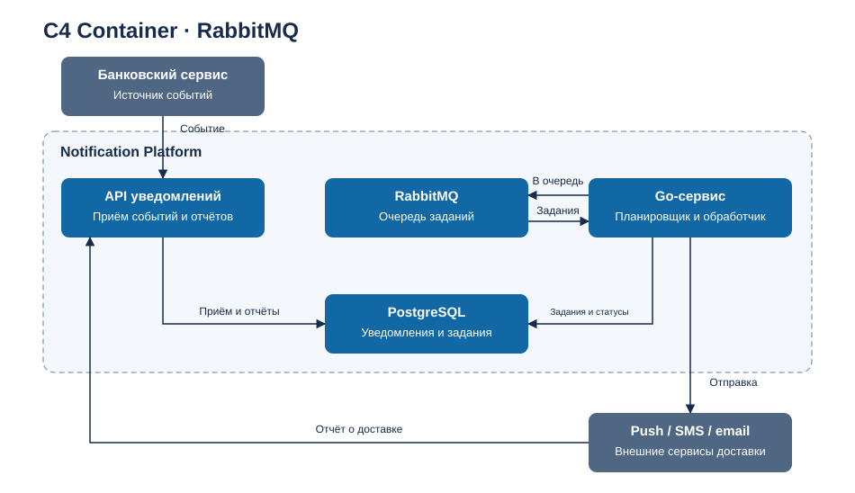
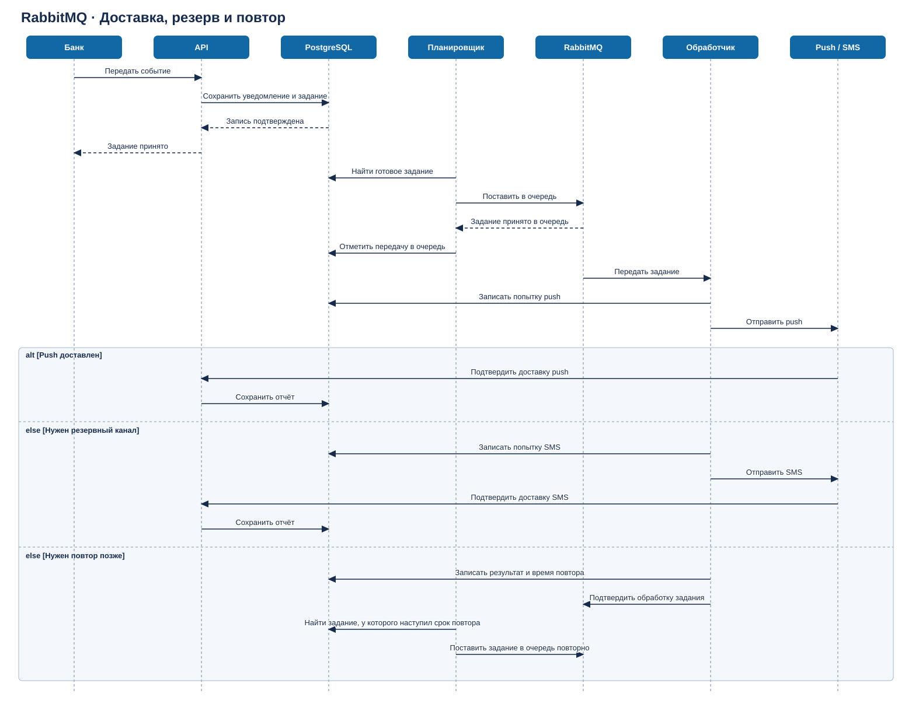
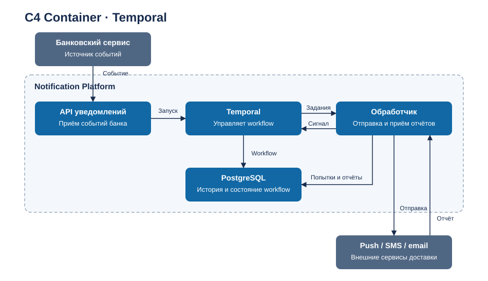
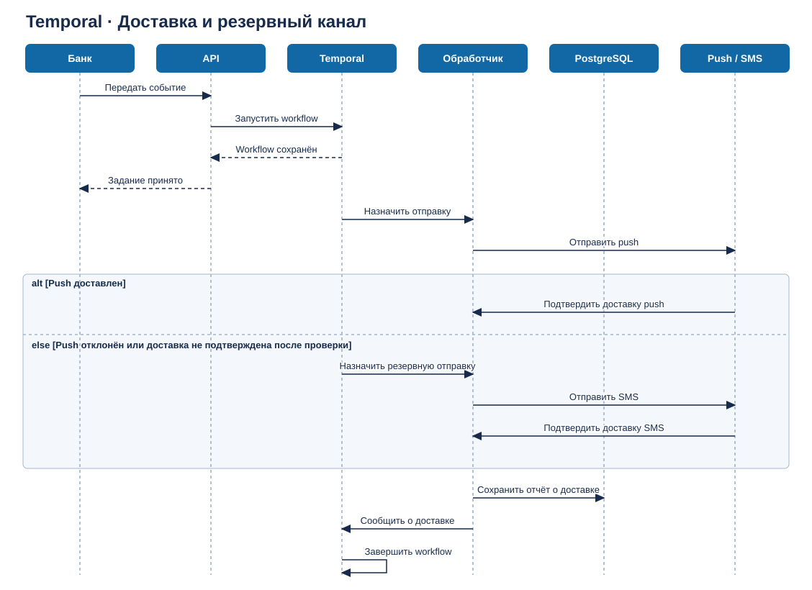

# RFC: Гарантированная доставка критичных уведомлений с кросс-канальным failover

| Метаданные | Значение |
|---|---|
| **Статус** | DRAFT |
| **Автор(ы)** | Илья Бычков |
| **Ответственный** | Алексей Белов |
| **Бизнес-заказчик** | Сергей Волков |
| **Ревьюеры** | Павел Соколов, 2026-11-20 (план) |
| **Дата создания** | 2026-11-16 |
| **Дата обновления** | 2026-11-17 |

## Оглавление

1. [Контекст](#контекст)
2. [Продуктовый анализ](#продуктовый-анализ)
3. [Пользовательские сценарии](#пользовательские-сценарии)
4. [Статистика](#статистика)
5. [Требования](#требования)
6. [Варианты решения](#варианты-решения)
7. [Сравнительный анализ](#сравнительный-анализ)
8. [Выводы](#выводы)
9. [Связанные задачи](#связанные-задачи)

## Контекст

Транзакционные уведомления (подтверждение перевода, списание средств и т.п.) являются критичными — их недоставка напрямую влияет на пользовательский опыт и безопасность. При этом каждый канал доставки (push, SMS, email) имеет свои характеристики надёжности, стоимости и задержки, а внешние провайдеры могут быть временно недоступны.

Необходимо спроектировать подсистему в рамках Notification Platform, которая:

- гарантирует доставку критичного уведомления хотя бы через один канал
- автоматически переключается на резервный канал при отказе основного
- учитывает пользовательские настройки (предпочтительный канал)
- минимизирует стоимость доставки (SMS значительно дороже push)
- обеспечивает наблюдаемость (observability) процесса доставки
- предотвращает дублирование уведомлений при failover

### Ключевые вопросы

Как сохранить уведомление при сбое, вовремя переключить канал и избежать повторной доставки?

## Продуктовый анализ

Уведомления о движении средств обязательны. Клиент может отключить маркетинговые и необязательные сервисные сообщения. Из разрешённых каналов с действующими контактами сначала пробуем предпочтительный, затем остальные в порядке push -> email -> SMS. SMS обычно последний из-за стоимости. 

## Пользовательские сценарии

| Приоритет | Тип сценария | Действующее лицо | Сценарий |
|---|---|---|---|
| MUST HAVE | Основной | Клиент | После перевода получает уведомление в предпочтительном канале. |
| MUST HAVE | Сбой канала | Клиент | Если push недоступен, получает уведомление по разрешённому email или SMS. |
| SHOULD HAVE | Разбор сбоя | Поддержка | По идентификатору уведомления видит каналы, результаты и причину переключения. |

## Статистика

10 млн активных пользователей в месяц, 3 млн в день, до 300 тыс. одновременно. На активного пользователя в день приходится 2 транзакционных, 3 сервисных и 5 маркетинговых уведомлений. Кампания охватывает до 1 млн получателей.

## Требования

### Функциональные требования

| № | Приоритет | Обозначение | Требование |
|---|---|---|---|
| 1 | MUST HAVE | FR1 | Платформа принимает уведомление и продолжает отправку после сбоя. |
| 2 | MUST HAVE | FR2 | Платформа учитывает настройки клиента и при сбое автоматически переключается на доступный резервный канал. |
| 3 | MUST HAVE | FR3 | Повторный запрос продолжает обработку того же уведомления. Подтверждение доставки останавливает новые попытки. |
| 4 | SHOULD HAVE | FR4 | Поддержка видит историю попыток и причину переключения канала. |

### Нефункциональные требования

| № | Приоритет | Обозначение | Требование |
|---|---|---|---|
| 1 | MUST HAVE | NFR1 | При штатной работе основного канала не менее 99% критичных уведомлений доставляются клиентам в течение 3 секунд после банковской операции. Требование действует при 500 критичных событиях в секунду на фоне массовой рассылки. |
| 2 | MUST HAVE | NFR2 | При отказе одного сервера или зоны теряется 0 принятых критичных уведомлений. |
| 3 | MUST HAVE | NFR3 | Не менее 99,9% критичных уведомлений, созданных за месяц, получают подтверждение доставки хотя бы по одному каналу до истечения срока актуальности. |
| 4 | SHOULD HAVE | NFR4 | За месяц не более 0,01% подтверждённо доставленных критичных уведомлений имеют подтверждённый дубль. |
| 5 | SHOULD HAVE | NFR5 | Поддержка видит статус в течение 10 секунд после получения результата попытки платформой. |

### Архитектурно значимые требования

| ASR | Приоритет | Связанные требования | Почему влияет на архитектуру |
|---|---|---|---|
| 1. Скорость при массовой рассылке | MUST HAVE | NFR1 | Критичным отправкам нужны отдельные ресурсы и квоты. |
| 2. Сохранность при сбоях | MUST HAVE | FR1, FR2, NFR2, NFR3 | Событие и статус попытки нужно сохранить для восстановления. |
| 3. Контроль дублей | MUST HAVE | FR2, FR3, NFR4 | Перед сменой канала нужен статус прежней попытки. |

### Расчёт нагрузок

| Нагрузка | Расчёт |
|---|---|
| Критичные уведомления | 3 млн × 2 = 6 млн/день, в среднем ≈ 70/с |
| Все уведомления | 3 млн × 10 = 30 млн/день, в среднем ≈ 350/с |

## Варианты решения

### Общие правила отправки

Банк сохраняет событие вместе с операцией и повторяет его передачу с тем же ID до подтверждения приёма. Платформа записывает каждую попытку перед вызовом провайдера и использует тот же ключ при повторе вызова, если провайдер поддерживает ключи.

При явном отказе пробуем следующий канал сразу. Если подтверждения нет в срок, по возможности проверяем статус у провайдера. Если доставку подтвердить не удалось, переключаемся. Перед отправкой по резервному каналу сверяем сохранённый статус. Временные сбои повторяем с паузой, пока сообщение актуально. При исчерпании каналов сохраняем статус "доставка не подтверждена".

Поздняя доставка через первый канал может создать дубль. Поздние отчёты сохраняем для учёта дублей, даже если обработка уже завершилась.

Логи по ID показывают канал, время и итог попытки. Метрики отслеживают скорость, доставку, дубли и расходы на SMS.

### Вариант 1: RabbitMQ и PostgreSQL

#### Архитектура

API сохраняет уведомление и задание одной транзакцией PostgreSQL и подтверждает приём после синхронной записи в другой зоне. В Go-сервисе две роли.

- **Планировщик** читает из PostgreSQL новые задания и задания, у которых наступило время повтора. Он кладёт их в quorum-очередь RabbitMQ в трёх зонах и после подтверждения помечает в PostgreSQL как "передано в очередь".
- **Обработчик** берёт задание из RabbitMQ и пробует отправить push. Он сохраняет результат в PostgreSQL. Только после записи он говорит RabbitMQ "это задание обработано". Если обработчик упадёт до подтверждения, RabbitMQ выдаст задание повторно.

#### Этапы реализации

| Этап | Описание | Планируемый срок | Ресурсы | Риски |
|---|---|---|---|---|
| 1 | Приём, очередь и push | 2 недели | 2 разработчика, SRE | Сбой между БД и очередью |
| 2 | Резервные каналы и испытания | 3 недели | 2 разработчика, QA | Поздние подтверждения |

#### Преимущества

Одна БД для заданий и истории.

#### Недостатки

Команда сама пишет планировщик и восстановление задач.

### Вариант 2: Temporal и PostgreSQL

#### Архитектура

API подтверждает приём после записи workflow. Temporal хранит ID и итог workflow на весь срок повторной передачи события, включая период после завершения. Temporal хранит состояние и таймеры в PostgreSQL с синхронной репликацией между зонами. Задачи выполняют Go-обработчики. Провайдер отправляет отчёт о доставке Go-обработчику. Обработчик сохраняет отчёт в PostgreSQL и сообщает Temporal о доставке. Если Temporal временно недоступен, обработчик повторяет передачу сигнала. Получив сигнал, Temporal завершает workflow. Поздние отчёты тоже сохраняются, чтобы учитывать дубли.

В примере после сбоя push платформа отправляет SMS, поскольку email недоступен.

#### Этапы реализации

| Этап | Описание | Планируемый срок | Ресурсы | Риски |
|---|---|---|---|---|
| 1 | Настройка Temporal и отправка push | 3 недели | 2 разработчика, SRE | Освоение Temporal |
| 2 | Резервные каналы и испытания | 3 недели | 2 разработчика, QA | Нагрузка на историю workflow |

#### Преимущества

Temporal сохраняет таймеры и возобновляет workflow.

#### Недостатки

Нужно обслуживать кластер Temporal.

## Сравнительный анализ

### Ресурсные требования

| Критерий | RabbitMQ | Temporal |
|---|---|---|
| Время реализации | 5 недель, включая разработку планировщика | 6 недель, включая развёртывание и освоение Temporal |
| Команда | 2 разработчика, QA, SRE | 2 разработчика, QA, SRE с опытом Temporal |
| Инфраструктура | RabbitMQ и PostgreSQL | Temporal и PostgreSQL |
| Что реализует команда | Планировщик, повторы, переходы между состояниями и восстановление | Правила смены канала, обработку отчётов и защиту от дублей. Таймеры и восстановление предоставляет Temporal. |
| Основной риск | Ошибки при повторах и восстановлении после сбоя | Понадобится опыт настройки и эксплуатации Temporal |

### Соответствие требованиям

| Требование | RabbitMQ | Temporal |
|---|---|---|
| ASR 1, NFR1. Скорость | Отдельные очередь, обработчики и квота | Отдельные очередь задач, обработчики и квота |
| ASR 2, FR1–FR2, NFR2–NFR3. Восстановление и доставка | Платформа хранит состояние в PostgreSQL. Планировщик по сохранённым срокам возвращает задания в очередь. | Temporal хранит состояние и таймеры, возобновляет workflow после сбоя и выдаёт следующую задачу. |
| ASR 3, FR2–FR3, NFR4. Дубли | Один ID уведомления. БД выделяет текущий шаг одному обработчику. | Один workflow на уведомление. При повторе задачи сохраняется ключ попытки. |
| FR4, NFR5. Статус | История попыток в PostgreSQL | История попыток в PostgreSQL |

## Выводы

**Выбор — Temporal и PostgreSQL.** Workflow описывает отправку, ожидание подтверждения и смену канала в одном месте. Temporal сохраняет текущий шаг и таймеры, поэтому команде проще реализовать и проверить восстановление после сбоя. При запуске придётся развернуть кластер Temporal. Для этой задачи принимаем эти затраты, поскольку они сокращают объём собственной логики повторов и восстановления. Перед запуском проверим скорость и сохранность при отказе зоны.

## Связанные задачи

1. Уточнить квоты и отчёты провайдеров.
2. Проверить скорость при 500 событиях/с на фоне рассылки и сохранность при отказе зоны.
3. Измерить доставки, дубли, задержку статуса и стоимость.
